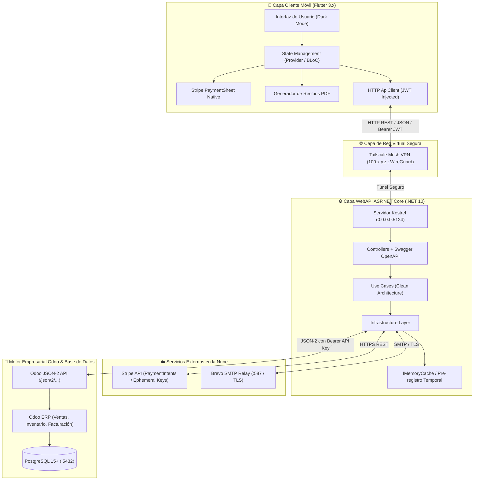
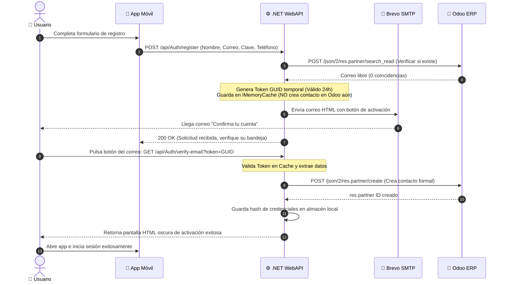
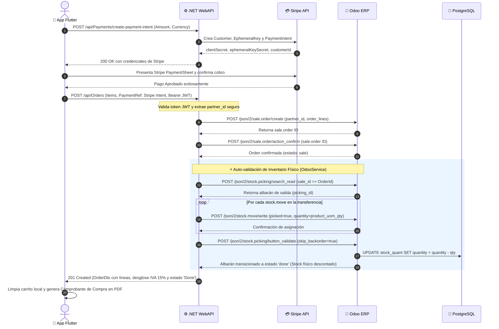

# 🛒 E-Commerce Móvil Integrado con Odoo ERP (.NET WebAPI + Flutter)

[](https://dotnet.microsoft.com/)
[](https://flutter.dev/)
[](https://dart.dev/)
[](https://www.odoo.com/)
[](https://www.postgresql.org/)
[](https://stripe.com/)
[](https://www.brevo.com/)
[](https://tailscale.com/)
[](https://blog.cleancoder.com/)
[](https://xunit.net/)
[](https://flutter.dev/)

---

## 📑 Tabla de Contenidos
1. [1. Título y Descripción General](#1-título-y-descripción-general)
2. [2. Stack Tecnológico y Arquitectura](#2-stack-tecnológico-y-arquitectura)
   - [2.1 Frontend Móvil (Flutter 3.x / Dart)](#21-frontend-móvil-flutter-3x--dart)
   - [2.2 Backend WebAPI (ASP.NET Core .NET 10 / C#)](#22-backend-webapi-aspnet-core-net-10--c)
   - [2.3 ERP & Base de Datos (Odoo ERP + PostgreSQL)](#23-erp--base-de-datos-odoo-erp--postgresql)
   - [2.4 Servicios Externos & Red (Stripe, Brevo, Tailscale)](#24-servicios-externos--red-stripe-brevo-tailscale)
   - [2.5 Diagrama de Arquitectura Global](#25-diagrama-de-arquitectura-global)
3. [3. Flujo Funcional del Sistema](#3-flujo-funcional-del-sistema)
   - [3.1 Pre-Registro y Verificación de Correo (Antifraude)](#31-pre-registro-y-verificación-de-correo-antifraude)
   - [3.2 Catálogo e Inventario en Tiempo Real](#32-catálogo-e-inventario-en-tiempo-real)
   - [3.3 Checkout, Cobro Nativo y Emisión de Comprobante](#33-checkout-cobro-nativo-y-emisión-de-comprobante)
   - [3.4 Diagrama de Secuencia Transaccional de Compra y Descuento Físico](#34-diagrama-de-secuencia-transaccional-de-compra-y-descuento-físico)
4. [4. Guía de Despliegue Desde Cero en un Equipo Nuevo](#4-guía-de-despliegue-desde-cero-en-un-equipo-nuevo)
   - [4.1 Prerrequisitos del Entorno](#41-prerrequisitos-del-entorno)
   - [4.2 Paso 1: Clonar el Repositorio](#paso-1-clonar-el-repositorio)
   - [4.3 Paso 2: Configuración y Despliegue de Odoo & Base de Datos](#paso-2-configuración-y-despliegue-de-odoo--base-de-datos)
   - [4.4 Paso 3: Configuración del Backend (.NET WebAPI)](#paso-3-configuración-del-backend-net-webapi)
   - [4.5 Paso 4: Configuración y Ejecución de la App Móvil (Flutter)](#paso-4-configuración-y-ejecución-de-la-app-móvil-flutter)
   - [4.6 Paso 5: Ejecución de la Suite de Pruebas Automatizadas](#paso-5-ejecución-de-la-suite-de-pruebas-automatizadas)
5. [5. Credenciales de Prueba y Notas de Seguridad](#5-credenciales-de-prueba-y-notas-de-seguridad)
   - [5.1 Buenas Prácticas de Secretos y Seguridad](#51-buenas-prácticas-de-secretos-y-seguridad)
   - [5.2 Credenciales y Usuarios Demo](#52-credenciales-y-usuarios-demo)
   - [5.3 Tarjetas de Prueba para la Pasarela Stripe](#53-tarjetas-de-prueba-para-la-pasarela-stripe)
6. [6. Estructura Exhaustiva del Proyecto](#6-estructura-exhaustiva-del-proyecto)
7. [7. Matriz de Endpoints de la WebAPI](#7-matriz-de-endpoints-de-la-webapi)
8. [8. Diagnóstico y Resolución de Problemas Frecuentes (Troubleshooting)](#8-diagnóstico-y-resolución-de-problemas-frecuentes-troubleshooting)

---

# 1. TÍTULO Y DESCRIPCIÓN GENERAL

* **Nombre Oficial:** E-Commerce Móvil Integrado con Odoo ERP (.NET WebAPI + Flutter)
* **Propósito del Proyecto:** 
  Aplicación móvil corporativa de comercio electrónico conectada a un backend de alto rendimiento en ASP.NET Core que orquesta transacciones reales, sincronización bidireccional de catálogo comercial, control estricto de existencias e inventario físico, y generación de órdenes de venta directamente en **Odoo ERP**. Integra una pasarela de pagos nativa moderna mediante **Stripe PaymentSheet** y un esquema robusto de verificación previa de identidad y correo electrónico vía **SMTP Relay (Brevo)**, blindando el sistema contra usuarios fantasmas y compras sin respaldo.

---

# 2. STACK TECNOLÓGICO Y ARQUITECTURA

El sistema está concebido bajo los principios de **Clean Architecture** (Arquitectura Limpia), logrando un desacoplamiento absoluto entre la lógica del dominio comercial, las reglas de aplicación y los adaptadores de infraestructura tecnológica.

```
┌────────────────────────────────────────────────────────────────────────┐
│                        ARQUITECTURA DEL SISTEMA                        │
│                                                                        │
│   [ Dispositivo Móvil ] ──(Tailscale VPN)──> [ ASP.NET Core WebAPI ]   │
│     Flutter 3.x / Dart                         Kestrel (:5124)         │
│     Clean Arch + BLoC/Provider                 Clean Architecture      │
│     Stripe PaymentSheet                        JWT Auth + Brevo SMTP   │
│                                                          │             │
│                                                          │             │
│                                                 (JSON-2 / Bearer Key)  │
│                                                          ▼             │
│                                                  [ Odoo ERP Engine ]   │
│                                                    Ventas + Stock      │
│                                                    PostgreSQL (:5432)  │
└────────────────────────────────────────────────────────────────────────┘
```

### 2.1 Frontend Móvil (Flutter 3.x / Dart)
* **Framework y Lenguaje:** Flutter 3.24+ / Dart 3.x (Canal Stable).
* **Gestión de Estado y Patrón:** Patrón BLoC / Provider (`provider: ^6.1.1`) para flujo unidireccional y reactivo de datos.
* **Diseño Arquitectónico:** Clean Architecture dividida en capas (`presentation`, `application`, `domain`, `infrastructure`).
* **Experiencia de Usuario:** Soporte estricto de **Modo Oscuro** (Dark Mode de alto contraste, ergonomía visual y accesibilidad visual).
* **Facturación Digital:** Emisión y previsualización de comprobantes fiscales impresos y exportación a PDF nativo mediante paquetes `pdf` y `printing`.
* **Persistencia Local:** `shared_preferences` para resguardo de token de sesión JWT y caché local de carrito de compras.

### 2.2 Backend WebAPI (ASP.NET Core .NET 10 / C#)
* **Framework:** ASP.NET Core sobre .NET 10 (C# 14).
* **Servidor Web:** Kestrel enlazado en el puerto `5124` escuchando en todas las interfaces de red (`0.0.0.0:5124`).
* **Arquitectura de Software:** Arquitectura Limpia en 4 proyectos independientes:
  1. `ECommerce.Domain`: Entidades (`Product`, `Category`, `Order`, `OrderItem`), Enums de estado y reglas puras sin librerías de terceros.
  2. `ECommerce.Application`: Casos de uso (`CreateOrderUseCase`, `GetProductsUseCase`, `LoginUseCase`, `RegisterUseCase`), DTOs y modelos unificados `ApiResponse<T>`.
  3. `ECommerce.Infrastructure`: Cliente Odoo JSON-2 (`OdooService`), servicio criptográfico de tokens JWT (`JwtTokenService`), persistencia de registros pendientes (`PendingRegistrationService`), pasarela Stripe y cliente de correo SMTP (`SmtpEmailService`).
  4. `ECommerce.WebApi`: Controladores RESTful (`AuthController`, `ProductsController`, `CategoriesController`, `OrdersController`, `PaymentsController`, `AddressesController`), middleware global de manejo de excepciones y Swagger OpenAPI.
* **Pruebas Automatizadas:** Suite completa con `xUnit`, `FluentAssertions` y `Moq` (91 pruebas unitarias y de integración pasando al 100%).

### 2.3 ERP & Base de Datos (Odoo ERP + PostgreSQL)
* **Motor ERP:** Odoo Community (v16, v17 o v18) actuando como el Core transaccional y ERP maestro de la empresa.
* **Módulos Críticos Requeridos:**
  * **Ventas (`sale_management`):** Gestión de cotizaciones y pedidos comerciales (`sale.order`).
  * **Inventario (`stock`):** Gestión de almacenes, movimientos físicos (`stock.move`) y transferencias de salida (`stock.picking`).
  * **Facturación (`account`):** Gestión de libros contables, impuestos y comprobantes mercantiles.
* **Base de Datos:** PostgreSQL 15+ ejecutándose sobre el puerto estándar `5432` con la base de datos `ecommerce_moviles`.
* **Protocolo de Conexión:** Integración mediante la **API JSON-2 oficial de Odoo** (`/json/2/{model}/{method}`) autenticada mediante cabeceras:
  * `Authorization: Bearer <API_KEY>`
  * `X-Odoo-Database: <DATABASE_NAME>`
  * `Content-Type: application/json`

### 2.4 Servicios Externos & Red (Stripe, Brevo, Tailscale)
* **Pasarela de Pagos (Stripe):** Integración oficial con Stripe API en backend (`Stripe.net`) y Stripe SDK nativo en Flutter (`flutter_stripe`). Empleo de `PaymentSheet` nativo con `Customer` y `EphemeralKeySecret` para resguardo de métodos de pago y procesamiento de tarjetas de prueba.
* **Notificaciones & Email Transaccional:** Relay Brevo SMTP (`smtp-relay.brevo.com:587` con TLS/SSL) para despacho automatizado de correos con formato HTML oscuro y botones dinámicos de activación.
* **Red y Conectividad (Tailscale VPN):** Red de malla privada basada en WireGuard. Asigna direcciones IP virtuales seguras (`100.x.y.z`) permitiendo que celulares físicos Android conectados a redes celulares 4G/5G o Wi-Fi se comuniquen transparentemente con el backend local sin requerir redirección de puertos en routers caseros.

---

### 2.5 Diagrama de Arquitectura Global



---

# 3. FLUJO FUNCIONAL DEL SISTEMA

### 3.1 Pre-Registro y Verificación de Correo (Antifraude)
Para garantizar la integridad de los datos en el ERP corporativo y evitar la creación de clientes inexistentes o correos maliciosos:
1. **Solicitud de Registro:** El cliente ingresa su nombre, correo, teléfono y contraseña en la aplicación móvil Flutter.
2. **Validación Previa en Odoo:** El backend consulta en Odoo (`/json/2/res.partner/search_read`) si el correo electrónico ya se encuentra registrado.
3. **Persistencia Temporal y Generación de Token:**
   * Si el correo es nuevo, el backend **NO crea todavía el registro en Odoo**.
   * Se genera un token criptográfico único (GUID) y los datos de registro se resguardan de forma segura en `IMemoryCache` con persistencia auxiliar en disco (`App_Data/pending_users.json`) con una vigencia exacta de **24 horas**.
4. **Despacho del Correo Transaccional:** Se emite un correo electrónico a través de **Brevo SMTP** con una plantilla HTML en estilo oscuro con un botón de acción rápida vinculado a:
   ```
   GET /api/Auth/verify-email?token={GUID_TOKEN}
   ```
5. **Activación de Cuenta:** Al pulsar el botón desde cualquier navegador o correo en su móvil:
   * El backend valida la existencia y vigencia del token.
   * Crea formalmente el contacto en Odoo (`/json/2/res.partner/create`).
   * Almacena sus credenciales en el almacén cifrado de contraseñas.
   * Elimina el token temporal y muestra una interfaz web de confirmación exitosa invitando al usuario a iniciar sesión en la app móvil.



---

### 3.2 Catálogo e Inventario en Tiempo Real
1. **Consulta Dinámica:** La aplicación consume `GET /api/Products`, el cual consulta `product.template` en Odoo solicitando campos clave (`id`, `name`, `list_price`, `qty_available`, `categ_id`, `image_128`).
2. **Filtro Defensivo de Stock Disponible:**
   * La lógica de aplicación en backend filtra rigurosamente las existencias:
     ```csharp
     return products.Where(p => p.Stock > 0).ToList();
     ```
   * **Beneficio:** Si un producto tiene existencias en 0 (`qty_available <= 0`), queda automáticamente excluido de la vitrina para el comprador, evitando ventas sin respaldo de almacén.
3. **Cálculo Fiscal Automático del IVA (15%):**
   * El sistema calcula de manera unificada y transparente el desglose de subtotal imponible, el **15% de Impuesto al Valor Agregado (IVA)** y el total final de la orden en el carrito, la pasarela y el comprobante.

---

### 3.3 Checkout, Cobro Nativo y Emisión de Comprobante
1. **Creación del Payment Intent (Stripe):**
   * El cliente selecciona los ítems y procede al pago.
   * La app invoca `POST /api/Payments/create-payment-intent`.
   * El backend localiza o crea el `Customer` en Stripe, genera una `EphemeralKey` y emite un `PaymentIntent` con el monto total en centavos.
2. **Presentación de Stripe PaymentSheet:**
   * La app móvil inicializa la hoja de pago nativa de Stripe (`Stripe.instance.initPaymentSheet`).
   * El usuario ingresa su tarjeta de crédito/débito y confirma.
3. **Orquestación y Descuento Físico en Odoo ERP:**
   * Una vez confirmado el cobro en Stripe, la app envía `POST /api/Orders` con el ID de transacción y el token JWT autenticado (extrayendo el `partner_id` del usuario para aislar su identidad).
   * La WebAPI crea la orden de venta en Odoo (`/json/2/sale.order/create`).
   * Confirma la orden administrativamente (`/json/2/sale.order/action_confirm`), cambiando su estado a `sale`.
   * **Salida de Almacén Inmediata (`stock.picking`):** Localiza el albarán de entrega asociado a la venta, actualiza las líneas de movimiento (`stock.move/write`) estableciendo `picked: true` y la cantidad exacta, y ejecuta la validación (`stock.picking/button_validate`) con bypass de asistentes (`skip_immediate: true`, `skip_backorder: true`), pasando el picking al estado final **`done`**. Esto descuenta las existencias a mano de forma física e irrevocable en Odoo.
4. **Comprobante de Pago en PDF:**
   * La aplicación renderiza una pantalla de éxito tipo recibo mercantil con líneas punteadas y habilita la descarga/impresión inmediata del comprobante en **PDF nativo**.

---

### 3.4 Diagrama de Secuencia Transaccional de Compra y Descuento Físico



---

# 4. GUÍA DE DESPLIEGUE DESDE CERO EN UN EQUIPO NUEVO

Sigue minuciosamente los siguientes pasos para desplegar y poner en funcionamiento todo el ecosistema en un equipo de desarrollo completamente nuevo.

### 4.1 Prerrequisitos del Entorno

Instala previamente las siguientes herramientas según tu sistema operativo:

| Herramienta | Versión Mínima Requerida | Enlace Oficial |
| :--- | :--- | :--- |
| **Git** | 2.40+ | [git-scm.com](https://git-scm.com/) |
| **.NET SDK** | .NET 10.0+ | [dotnet.microsoft.com](https://dotnet.microsoft.com/download) |
| **Flutter SDK** | 3.24+ (Canal Stable) | [docs.flutter.dev](https://docs.flutter.dev/get-started/install) |
| **Android Studio / SDK** | Ladybug / Koala o superior | [developer.android.com/studio](https://developer.android.com/studio) |
| **PostgreSQL** | 15 o 16 | [postgresql.org](https://www.postgresql.org/download/) |
| **Odoo Community** | 16, 17 o 18 (o Docker) | [odoo.com/page/download](https://www.odoo.com/page/download) |
| **Tailscale** *(Móvil Físico)* | Última versión | [tailscale.com](https://tailscale.com/download) |

---

### 4.2 Paso 1: Clonar el Repositorio

Abre tu terminal favorita (PowerShell, Bash o Git Bash) y ejecuta:

```bash
git clone https://github.com/Isra1322/Proyecto_Moviles.git
cd Proyecto_Moviles
```

---

### 4.3 Paso 2: Configuración y Despliegue de Odoo & Base de Datos

1. **Asegurar PostgreSQL y Odoo:**
   * Verifica que el servicio de **PostgreSQL** esté escuchando en el puerto `5432`.
   * Inicia tu instancia local de **Odoo** en `http://localhost:8069`.

2. **Crear la Base de Datos:**
   * Dirígete en tu navegador a:
     👉 `http://localhost:8069/web/database/manager`
   * Haz clic en **Create Database** e ingresa el nombre exacto:
     * **Database Name:** `ecommerce_moviles`
     * **Email / Login:** `admin` (o tu correo personal)
     * **Password:** Tu contraseña de administración

3. **Instalación de Módulos Requeridos:**
   * Ingresa a Odoo y navega a la sección **Aplicaciones (Apps)**.
   * Retira el filtro por defecto "Aplicaciones" para ver todos los módulos e instala:
     * 🛒 **Ventas** (`sale_management`)
     * 📦 **Inventario** (`stock`)
     * 💳 **Facturación** (`account`)

4. **Generación de la API Key en Odoo:**
   * Haz clic en el avatar del usuario administrador (esquina superior derecha) > **Preferencias (My Profile)**.
   * Ve a la pestaña **Seguridad de la cuenta** (o Account Security).
   * En la sección **Claves API para desarrolladores**, haz clic en **Nueva clave API**.
   * Asigna una descripción (ej. `WebAPI .NET Key`) y copia la clave generada (ejemplo: `288d77e4b08fec48b922f762976de30bec73fd69_oak`).

5. **Sembrado Opcional de Catálogo:**
   * Para poblar de inmediato 4 categorías comerciales con 40 productos y stock disponible, ejecuta desde la raíz:
     ```bash
     python cargar_catalogo.py
     ```

---

### 4.4 Paso 3: Configuración del Backend (.NET WebAPI)

1. **Archivos de Configuración:**
   Verifica y edita los archivos:
   * `backend/ECommerce.WebApi/appsettings.json`
   * `backend/ECommerce.WebApi/appsettings.Development.json`

   Asegúrate de que la estructura contenga los parámetros reales:

   ```json
   {
     "Logging": {
       "LogLevel": {
         "Default": "Information",
         "Microsoft.AspNetCore": "Warning"
       }
     },
     "AllowedHosts": "*",
     "OdooSettings": {
       "Url": "http://127.0.0.1:8069",
       "Database": "ecommerce_moviles",
       "ApiKey": "TU_ODOO_API_KEY_AQUI",
       "TimeoutSeconds": 30
     },
     "Jwt": {
       "Key": "ClaveSecretaSuperSeguraParaECommerceProyectoFinal2026_Minimo32Caracteres!",
       "Issuer": "ECommerce.WebApi",
       "Audience": "ECommerce.MobileApp",
       "ExpireDays": 7
     },
     "StripeSettings": {
       "PublishableKey": "pk_test_TU_CLAVE_PUBLICA_STRIPE",
       "SecretKey": "sk_test_TU_CLAVE_PRIVADA_STRIPE"
     },
     "SmtpSettings": {
       "Host": "smtp-relay.brevo.com",
       "Port": 587,
       "EnableSsl": true,
       "UserName": "tu_usuario_brevo@smtp-brevo.com",
       "Password": "tu_master_password_smtp_brevo",
       "SenderEmail": "tu_correo_verificado@dominio.com",
       "SenderName": "E-Commerce Móvil",
       "BaseUrl": "http://TU_IP_O_TAILSCALE:5124"
     },
     "Cors": {
       "AllowedOrigins": [
         "http://localhost:5124",
         "http://127.0.0.1:5124"
       ]
     }
   }
   ```

2. **Habilitar el Puerto 5124 en el Firewall de Windows:**
   Si realizarás pruebas desde un dispositivo móvil real mediante Tailscale o red local, abre una consola de **PowerShell como Administrador** y ejecuta:

   ```powershell
   New-NetFirewallRule -DisplayName "Ecommerce Backend Port 5124" -Direction Inbound -LocalPort 5124 -Protocol TCP -Action Allow
   ```

3. **Restaurar, Compilar y Levantar el Backend:**
   Abre una terminal en la raíz del repositorio y ejecuta:

   ```bash
   cd backend/ECommerce.WebApi
   dotnet restore
   dotnet build
   dotnet run
   ```

4. **Verificación en Swagger:**
   El servidor Kestrel se iniciará enlazado en `http://0.0.0.0:5124`.
   Comprueba el funcionamiento ingresando en tu navegador a:
   * **Local:** 👉 `http://localhost:5124/swagger`
   * **Tailscale:** 👉 `http://100.x.y.z:5124/swagger`

---

### 4.5 Paso 4: Configuración y Ejecución de la App Móvil (Flutter)

1. **Configurar la IP del Backend en Flutter:**
   Abre el archivo:
   👉 `mobile/ecommerce_app/lib/core/constants/api_constants.dart`

   Configura la constante `baseUrl` con la IP de la máquina donde corre el backend:

   ```dart
   class ApiConstants {
     // Opción A: Dispositivo físico real mediante Tailscale VPN (Recomendado)
     static const String baseUrl = 'http://100.101.117.77:5124';

     // Opción B: Emulador oficial de Android Studio
     // static const String baseUrl = 'http://10.0.2.2:5124';

     // Opción C: Ejecución local en Windows Desktop
     // static const String baseUrl = 'http://localhost:5124';

     static const String products = '/api/Products';
     static const String categories = '/api/Categories';
     static const String orders = '/api/Orders';
     static const String paymentMethods = '/api/PaymentMethods';
     static const String createPaymentIntent = '/api/Payments/create-payment-intent';
     static const String addresses = '/api/Addresses';
     static const String login = '/api/Auth/login';
     static const String register = '/api/Auth/register';

     static const Duration timeout = Duration(seconds: 30);
   }
   ```

2. **Instalar Dependencias y Ejecutar:**
   Conecta tu dispositivo móvil con Depuración USB habilitada (o abre un Emulador) y ejecuta:

   ```bash
   cd mobile/ecommerce_app
   flutter pub get
   flutter run
   ```

3. **Compilación de Instalador APK para Distribución:**
   Si deseas generar el instalador APK independiente:
   ```bash
   cd mobile/ecommerce_app
   flutter build apk --split-per-abi
   ```
   El binario optimizado para procesadores móviles modernos se generará en:
   📁 `mobile/ecommerce_app/build/app/outputs/flutter-apk/app-arm64-v8a-release.apk`

---

### 4.6 Paso 5: Ejecución de la Suite de Pruebas Automatizadas

Para validar que todos los casos de uso, lógica de cálculo fiscal, controladores y componentes móviles operen con total estabilidad:

#### 1. Pruebas Automatizadas del Backend (.NET xUnit)
Desde la raíz del repositorio o dentro de la carpeta `backend/ECommerce.Tests`:
```bash
dotnet test backend/ECommerce.Tests/ECommerce.Tests.csproj
```
> **Resultado Garantizado:** 91 pruebas ejecutadas exitosamente (100% pasando).

#### 2. Pruebas Automatizadas del Frontend (Flutter Test)
Desde la carpeta de la aplicación móvil:
```bash
cd mobile/ecommerce_app
flutter test
```
> **Resultado Garantizado:** 111 pruebas de widgets, validadores, integración Stripe y lógica de facturación pasando al 100%.

---

# 5. CREDENCIALES DE PRUEBA Y NOTAS DE SEGURIDAD

### 5.1 Buenas Prácticas de Secretos y Seguridad
* **Protección de Llaves Privadas:** Las claves secretas de producción (`StripeSettings:SecretKey`, contraseñas maestras SMTP y API Keys de Odoo) **nunca deben commitearse en repositorios públicos**. Para entornos productivos se recomienda el uso de variables de entorno de sistema o **.NET User Secrets** (`dotnet user-secrets`).
* **Aislamiento de Identidad por Claims:** En la WebAPI, ningún cliente puede alterar o suplantar el `partner_id` de otro usuario en las órdenes. El controlador extrae el identificador del comprador directamente de la firma criptográfica del token Bearer JWT.

### 5.2 Credenciales y Usuarios Demo
Puedes realizar el registro de un nuevo usuario en menos de 1 minuto completando el formulario en la app móvil y confirmando el correo en tu bandeja personal.

Para pruebas inmediatas sin acceso a correo, puedes utilizar los usuarios precargados en el entorno de desarrollo:

| Rol | Correo Electrónico | Contraseña Demo | Observación |
| :--- | :--- | :--- | :--- |
| **Cliente Demo 1** | `cliente.demo@ecommerce.com` | `Password123!` | Cuenta verificada en Odoo |
| **Cliente Demo 2** | `isra@gmail.com` | `root` | Usuario vinculado a datos de prueba |
| **Administrador Odoo** | `admin` | *(Definida al crear BD)* | Acceso al panel web de Odoo |

### 5.3 Tarjetas de Prueba para la Pasarela Stripe
Al ejecutar compras desde la app móvil en modo test con Stripe PaymentSheet, utiliza las tarjetas oficiales de prueba de Stripe:

* **Número de Tarjeta:** `4242 4242 4242 4242`
* **Fecha de Expiración:** Cualquier fecha futura (ej. `12/28`)
* **CVC:** Cualquier número de 3 dígitos (ej. `123`)
* **Código Postal:** `12345` o cualquier código válido

---

# 6. ESTRUCTURA EXHAUSTIVA DEL PROYECTO

```text
Proyecto_Moviles/
├── README.md                                  # Documentación técnica integral
├── ECommerceProject.slnx                      # Solución unificada .NET 10
├── cargar_catalogo.py                         # Script para siembra rápida de productos en Odoo
├── actualizar_descripciones.py                # Script de enriquecimiento de catálogo
│
├── backend/                                   # Capa Backend ASP.NET Core (.NET 10)
│   ├── ECommerce.Domain/                      # Reglas de negocio nucleares
│   │   ├── Entities/                          # Product.cs, Category.cs, Order.cs, OrderItem.cs, Address.cs
│   │   └── Enums/                             # OrderStatus.cs (Draft, Confirmed, Done, Cancelled)
│   │
│   ├── ECommerce.Application/                 # Casos de uso y contratos de orquestación
│   │   ├── Common/                            # Modelos genéricos (ApiResponse.cs) y excepciones
│   │   ├── DTOs/                              # Auth, Orders, Products, Payments, Addresses
│   │   ├── Interfaces/                        # IOdooService, IJwtTokenService, IEmailService, IPendingRegistrationService
│   │   └── UseCases/                          # Casos de uso (CreateOrder, GetProducts, Login, Register, etc.)
│   │
│   ├── ECommerce.Infrastructure/              # Adaptadores externos y servicios de persistencia
│   │   ├── Configuration/                     # OdooSettings.cs, StripeSettings.cs, SmtpSettings.cs
│   │   ├── Mappers/                           # OdooProductMapper.cs, OdooOrderMapper.cs, OdooJsonHelper.cs
│   │   ├── Odoo/                              # Modelos RPC y OdooService.cs (Cliente JSON-2 / Bearer API Key)
│   │   └── Services/                          # SmtpEmailService.cs, PendingRegistrationService.cs, JwtTokenService.cs
│   │
│   ├── ECommerce.WebApi/                      # API RESTful en ASP.NET Core
│   │   ├── Controllers/                       # AuthController, ProductsController, CategoriesController, OrdersController, PaymentsController, AddressesController
│   │   ├── Middlewares/                       # ExceptionHandlingMiddleware.cs
│   │   ├── appsettings.json                   # Configuración del entorno
│   │   ├── appsettings.Development.json       # Configuración para desarrollo local
│   │   └── Program.cs                         # Configuración Kestrel (:5124), DI, JWT, CORS y Swagger
│   │
│   └── ECommerce.Tests/                       # Suite de pruebas unitarias e integración (91 tests passing)
│
└── mobile/ecommerce_app/                      # Capa Frontend Móvil en Flutter 3.x
    ├── pubspec.yaml                           # Dependencias (provider, flutter_stripe, pdf, printing, http)
    ├── lib/
    │   ├── main.dart                          # Inicialización de la app, Stripe SDK y temas
    │   ├── core/                              # Componentes transversales
    │   │   ├── constants/                     # api_constants.dart, app_colors.dart
    │   │   ├── theme/                         # app_theme.dart (Modo Oscuro estricto)
    │   │   └── utils/                         # Formateadores de moneda, teléfono, IVA y fecha
    │   ├── domain/                            # Entidades y contratos de repositorio móvil
    │   ├── infrastructure/                    # ApiClient (inyección Bearer), repositorios y modelos
    │   ├── application/                       # Casos de uso de la app móvil
    │   └── presentation/                      # UI y gestión de estado
    │       ├── providers/                     # AuthProvider, CartProvider, ProductProvider, OrderProvider
    │       ├── screens/                       # Pantallas (Catálogo, Categorías, Carrito, Stripe Checkout, Recibo PDF, Perfil)
    │       └── widgets/                       # Componentes visuales reutilizables
    └── test/                                  # Suite de pruebas móviles (111 tests passing)
```

---

# 7. MATRIZ DE ENDPOINTS DE LA WEBAPI

Todos los endpoints retornan una estructura de respuesta unificada:

```json
{
  "success": true,
  "message": "Mensaje explicativo de la operación.",
  "data": { ... },
  "errors": []
}
```

| Método | Endpoint | Autenticación | Descripción Funcional |
| :--- | :--- | :---: | :--- |
| `POST` | `/api/Auth/login` | Pública | Autentica cliente contra Odoo/credenciales locales. Emite token JWT con claim `partner_id`. |
| `POST` | `/api/Auth/register` | Pública | Inicia pre-registro con token GUID y envía correo de verificación vía Brevo SMTP. |
| `GET` | `/api/Auth/verify-email` | Pública | Endpoint web de activación. Valida el token, crea el contacto en Odoo (`res.partner`) y activa login. |
| `GET` | `/api/Products` | Pública | Retorna catálogo de productos. **Excluye automáticamente productos con stock en 0**. |
| `GET` | `/api/Products/{id}` | Pública | Obtiene detalle individual de un producto con descripción e imagen. |
| `GET` | `/api/Categories` | Pública | Lista las categorías comerciales disponibles en el ERP (`product.category`). |
| `POST` | `/api/Payments/create-payment-intent` | 🔒 **Bearer JWT** | Crea cliente, clave efímera y `PaymentIntent` en Stripe para inicializar el `PaymentSheet`. |
| `POST` | `/api/Orders` | 🔒 **Bearer JWT** | Crea `sale.order` en Odoo, ejecuta `action_confirm` y valida `stock.picking` descontando inventario. |
| `GET` | `/api/Orders` | 🔒 **Bearer JWT** | Retorna el historial de compras del usuario autenticado. |
| `GET` | `/api/Orders/{id}` | 🔒 **Bearer JWT** | Retorna el detalle completo de una orden con desglose del 15% de IVA para emisión de comprobante PDF. |
| `GET` | `/api/Addresses` | 🔒 **Bearer JWT** | Consulta las direcciones de entrega registradas para el cliente en Odoo. |
| `POST` | `/api/Addresses` | 🔒 **Bearer JWT** | Registra una nueva dirección de envío asociada al contacto en Odoo. |

---

# 8. DIAGNÓSTICO Y RESOLUCIÓN DE PROBLEMAS FRECUENTES (TROUBLESHOOTING)

### 1. Error de Conexión: `Failed to connect to /100.x.y.z:5124`
* **Causa:** El teléfono móvil y la máquina host no están conectados a la misma red Tailscale o la regla de firewall no está activa.
* **Solución:**
  1. Verifica que la aplicación Tailscale en la PC y en el celular se encuentren en estado **Connected**.
  2. Confirma que la IP configurada en `api_constants.dart` sea la IP exacta de Tailscale de la PC.
  3. Ejecuta el comando de PowerShell para habilitar el puerto `5124` en el Firewall de Windows.

### 2. Conflicto de Puerto: `address already in use http://0.0.0.0:5124`
* **Causa:** Quedó una instancia previa de `ECommerce.WebApi` ejecutándose en segundo plano.
* **Solución:** Ejecuta en PowerShell:
  ```powershell
  Stop-Process -Name "ECommerce.WebApi" -Force -ErrorAction SilentlyContinue
  ```

### 3. El Correo de Verificación no Llega a la Bandeja
* **Causa:** Las credenciales de Brevo SMTP no coinciden o el correo del remitente no está autorizado en Brevo.
* **Solución:**
  1. Ingresa a la consola de Brevo (Sendinblue) y verifica que el remitente configurado en `SmtpSettings:SenderEmail` esté validado.
  2. Revisa la carpeta de *Spam / Correo No Deseado*.

### 4. La Pasarela Stripe no Abre el PaymentSheet en Android
* **Causa:** Falta configurar el tema de la actividad en Android o la clave pública es inválida.
* **Solución:**
  1. Verifica que `MainActivity.kt` herede de `FlutterFragmentActivity`.
  2. Confirma que la clave pública en `appsettings.json` comience con `pk_test_`.

---

## 👥 Equipo de Desarrollo y Créditos
Proyecto desarrollado como solución integral de fin de semestre para la asignatura de **Aplicaciones Móviles** (Noviembre 2026), integrando arquitectura de software moderna, comercio móvil nativo y sincronización de recursos empresariales en tiempo real con Odoo ERP.
