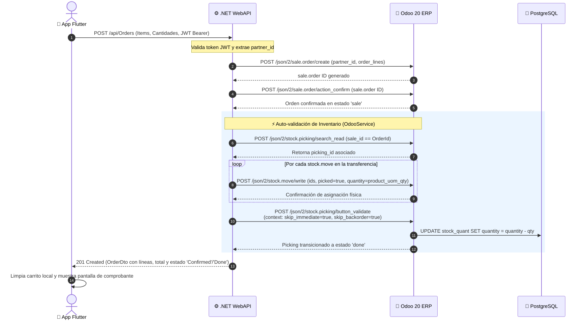

# 🛒 E-Commerce Multiplataforma (.NET WebAPI + Flutter + Odoo 20)

[](https://dotnet.microsoft.com/)
[](https://flutter.dev/)
[](https://dart.dev/)
[](https://www.odoo.com/)
[](https://www.postgresql.org/)
[](https://jwt.io/)
[](https://tailscale.com/)
[](https://blog.cleancoder.com/)

---

## 📑 Tabla de Contenidos
1. [Portada y Descripción General](#1-portada-y-descripción-general)
2. [Arquitectura del Sistema](#2-arquitectura-del-sistema)
   - [Diagrama de Flujo y Componentes](#diagrama-de-flujo-y-componentes)
   - [Frontend Móvil (Flutter)](#frontend-móvil-flutter)
   - [Backend (.NET 10 WebAPI)](#backend-net-10-webapi)
   - [ERP & Base de Datos (Odoo 20 + PostgreSQL)](#erp--base-de-datos-odoo-20--postgresql)
   - [Red y Acceso Remoto (Tailscale Mesh VPN)](#red-y-acceso-remoto-tailscale-mesh-vpn)
3. [Flujo Crítico de Negocio (Ciclo de Vida de una Compra)](#3-flujo-crítico-de-negocio-ciclo-de-vida-de-una-compra)
   - [Lógica de Descuento Físico de Inventario](#lógica-de-descuento-físico-de-inventario)
   - [Diagrama de Secuencia Transaccional](#diagrama-de-secuencia-transaccional)
4. [Prerrequisitos del Entorno](#4-prerrequisitos-del-entorno)
5. [Guía Paso a Paso para Despliegue en Otra PC](#5-guía-paso-a-paso-para-despliegue-en-otra-pc)
   - [Paso 1: Clonar el Repositorio](#paso-1-clonar-el-repositorio)
   - [Paso 2: Base de Datos y Odoo 20](#paso-2-base-de-datos-y-odoo-20)
   - [Paso 3: Ejecutar el Backend (.NET WebAPI)](#paso-3-ejecutar-el-backend-net-webapi)
   - [Paso 4: Ejecutar la App Móvil (Flutter)](#paso-4-ejecutar-la-app-móvil-flutter)
   - [Paso 5: Generación del Instalador APK](#paso-5-generación-del-instalador-apk)
6. [Estructura del Repositorio](#6-estructura-del-repositorio)
7. [Referencia de Endpoints (API RESTful)](#7-referencia-de-endpoints-api-restful)
8. [Resolución de Problemas Frecuentes (Troubleshooting)](#8-resolución-de-problemas-frecuentes-troubleshooting)

---

# 1. Portada y Descripción General

**E-Commerce Multiplataforma (.NET WebAPI + Flutter + Odoo 20)** es una solución empresarial moderna diseñada para ofrecer una experiencia de comercio electrónico fluida, reactiva y transaccionalmente consistente. Conecta una aplicación cliente móvil multiplataforma desarrollada en **Flutter** con el motor ERP corporativo **Odoo 20** a través de una API intermediaria de alto rendimiento construida en **ASP.NET Core (.NET 10)**.

### Características Principales:
* **Autenticación y Seguridad:** Autenticación de clientes basada en JSON Web Tokens (JWT) y credenciales de Odoo, con aislamiento estricto de identidad a nivel de Claims (`partner_id`).
* **Catálogo Dinámico e Interactivo:** Búsqueda en tiempo real, categorización visual con iconografía reactiva, filtrado por rangos de precio con slider continuo y múltiples criterios de ordenamiento (A-Z, Z-A, menor/mayor precio).
* **Gestión de Carrito de Compras:** Carrito persistente en el dispositivo con soporte para actualización de cantidades, eliminación individual o vaciado completo, sincronizado con las existencias del ERP.
* **Facturación con Desglose Fiscal (IVA 15%):** Visualización de comprobante estilo recibo/ticket mercantil con línea punteada, fecha de emisión, desglose de subtotal, IVA del 15% y total formal.
* **Sincronización en Tiempo Real y Salida Física de Inventario:** Confirmación instantánea de órdenes de venta (`sale.order`) y auto-validación de transferencias de almacén (`stock.picking`), garantizando el descuento inmediato de stock a mano (`qty_available` / On Hand).

---

# 2. Arquitectura del Sistema

El ecosistema aplica los principios de **Clean Architecture** (Arquitectura Limpia) tanto en el backend como en el frontend móvil, desacoplando completamente las reglas de negocio de la infraestructura tecnológica.

### Diagrama de Flujo y Componentes

```mermaid
flowchart LR
    subgraph Client["📱 Capa Cliente (Mobile)"]
        Flutter["Flutter Mobile App<br/>(Android / iOS / Desktop)"]
    end

    subgraph Network["🌐 Red Privada Segura"]
        Tailscale["Tailscale Mesh VPN<br/>(100.x.y.z : WireGuard)"]
    end

    subgraph Backend["⚙️ Capa Intermediaria (.NET 10)"]
        Kestrel["ASP.NET Core WebAPI<br/>(Kestrel HTTP :5124)"]
        CleanArch["Clean Architecture<br/>(Domain / App / Infra / WebApi)"]
    end

    subgraph ERP["🏢 Motor Transaccional ERP"]
        Odoo["Odoo 20 Community<br/>(JSON-RPC 2.0 / HTTP :8069)"]
        Postgres[("PostgreSQL 16+<br/>(:5432)")]
    end

    Flutter <-->|HTTP REST / JSON / JWT| Tailscale
    Tailscale <-->|Proxy WireGuard| Kestrel
    Kestrel --- CleanArch
    CleanArch <-->|JSON-RPC 2.0 / json/2| Odoo
    Odoo <-->|SQL / Conexión Nativa| Postgres
```



### Frontend Móvil (Flutter)
* **Arquitectura:** Clean Architecture estructurada en cuatro capas: `Presentation`, `Application`, `Domain` e `Infrastructure`.
* **Comunicación HTTP:** Implementación de cliente de red (`ApiClient`) con inyección automática de encabezados `Authorization: Bearer <token>`, manejo centralizado de excepciones y timeouts configurables.
* **Control de Sesión:** Persistencia local mediante `shared_preferences` para almacenar tokens JWT y datos de sesión de cliente de forma segura.
* **Validaciones Estrictas en Formularios:** Uso de `EmailInputFormatter`, `LowerCaseTextFormatter` y expresiones regulares estrictas en tiempo de escritura para sanitizar y validar correos electrónicos y números de teléfono sin permitir caracteres inválidos ni dobles signos.
* **Navegación:** `BottomNavigationBar` ergonómico en `MainNavigationScreen` con pestañas para Catálogo, Categorías, Carrito y Perfil.
* **Módulo de Catálogo:** Búsqueda en vivo con debounce, filtros por rango de precio (BottomSheet), ordenamiento configurable y badges de productos.
* **Categorías con Iconografía Dinámica:** Asignación visual automática de íconos según palabras clave (ej. procesadores, telefonía, monitores, audio, accesorios).
* **Pantalla de Perfil:** Dashboard de usuario con métricas acumuladas (total histórico gastado, pedidos confirmados, conteo total de órdenes) y accesos directos.
* **Comprobante de Pedido tipo Recibo:** `OrderDetailScreen` renderiza un ticket con estilo visual impreso, divisores punteados (`DottedDivider`), información del cliente, estado en tiempo real y desglose de IVA (15%).

### Backend (.NET 10 WebAPI)
* **Estructura en 4 Capas (Clean Architecture):**
  1. `ECommerce.Domain`: Entidades nucleares (`Product`, `Category`, `Order`, `OrderItem`), Enums de dominio (`OrderStatus`) y contratos esenciales libres de dependencias externas.
  2. `ECommerce.Application`: Casos de uso (`CreateOrderUseCase`, `GetOrdersUseCase`, `GetProductByIdUseCase`, etc.), DTOs y mapeos hacia modelos de respuesta unificados `ApiResponse<T>`.
  3. `ECommerce.Infrastructure`: Cliente Odoo JSON-RPC 2.0 / JSON2 (`OdooService`), servicio de tokens criptográficos (`JwtTokenService`), almacenamiento seguro de credenciales (`CustomerCredentialStore`) y mappers defensivos JSON.
  4. `ECommerce.WebApi`: Controladores RESTful (`AuthController`, `ProductsController`, `CategoriesController`, `OrdersController`), middleware de excepciones global (`ExceptionHandlingMiddleware`) y configuración de CORS.
* **Seguridad y JWT:** Emisión de tokens firmados simétricamente con algoritmos HMAC-SHA256 y expiración configurable.
* **Documentación Interactiva:** Integración nativa de OpenAPI con Swagger UI y esquemas de autorización Bearer.
* **Manejo Defensivo de Excepciones:** Respuestas estandarizadas ante `UnauthorizedAccessException`, `NotFoundException`, `ArgumentException` y `OdooIntegrationException`.

### ERP & Base de Datos (Odoo 20 + PostgreSQL)
* **Modelos Odoo Gestionados:**
  * `res.partner`: Registro, consulta y autenticación de clientes.
  * `product.template` y `product.product`: Gestión de catálogo, precios de lista, categorías, códigos de barra e imágenes.
  * `sale.order` y `sale.order.line`: Creación, cotización y confirmación formal de pedidos de venta.
  * `stock.picking` y `stock.move`: Gestión de albaranes de salida de almacén y movimientos de stock físico.
* **Persistencia:** Base de datos relacional PostgreSQL 16 ejecutándose en el puerto estándar `5432`.

### Red y Acceso Remoto (Tailscale Mesh VPN)
Para permitir que dispositivos móviles Android físicos reales se comuniquen con la WebAPI que corre en una máquina de desarrollo (laptop), se utiliza **Tailscale**. La red de malla WireGuard asigna una IP fija de rango `100.x.y.z`, superando restricciones de NAT, firewalls de routers residenciales y aislamiento de clientes en redes Wi-Fi públicas.

---

# 3. Flujo Crítico de Negocio (Ciclo de Vida de una Compra)

Uno de los mayores retos técnicos en las integraciones con Odoo radica en garantizar que una orden de venta no se quede únicamente en estado cotización o confirmación administrativa, sino que **descuente inmediatamente el inventario físico en tiempo real**.

### Lógica de Descuento Físico de Inventario



### Detalle Paso a Paso de la Implementación:

1. **Recepción y Validación de Solicitud (`POST /api/Orders`):**
   * El cliente móvil envía la lista de ítems (`ProductId`, `Quantity`, `UnitPrice`).
   * El controlador `OrdersController` extrae el `partner_id` directamente del Claim autenticado del token JWT para prevenir suplantación de identidad.
2. **Creación y Confirmación en Odoo ERP:**
   * La WebAPI ejecuta el endpoint `/json/2/sale.order/create` creando la orden con sus respectivas líneas (`sale.order.line`).
   * A continuación, invoca `/json/2/sale.order/action_confirm`. Esto coloca la orden en estado `'sale'` y genera automáticamente el albarán de entrega (`stock.picking`) en el módulo de Inventario.
3. **Auto-Validación Defensiva del Albarán (`stock.picking`):**
   * El servicio localiza la transferencia asociada mediante una búsqueda en `stock.picking` filtrando por `sale_id = OrderId`.
   * **Asignación en `stock.move`:** Para cada línea de movimiento vinculada, se ejecuta `/json/2/stock.move/write` asignando:
     ```json
     {
       "picked": true,
       "quantity": product_uom_qty
     }
     ```
     *(Con fallback a `quantity_done` si la versión del modelo lo requiere).*
   * **Bypass de Asistentes y Validación:** Se invoca `/json/2/stock.picking/button_validate` enviando en el diccionario de contexto:
     ```json
     {
       "skip_immediate": true,
       "skip_backorder": true,
       "skip_sms": true,
       "skip_sanity_check": true,
       "button_validate_picking_ids": [ <picking_id> ]
     }
     ```
   * Odoo traslada el albarán al estado **`done`**, produciendo la afectación física sobre los quants de almacén y descontando el stock a mano (`qty_available` / On Hand).
   * La operación se encapsula en bloques `try-catch` defensivos para garantizar que la respuesta del pedido al cliente sea exitosa e ininterrumpida.

---

# 4. Prerrequisitos del Entorno

Antes de comenzar la instalación en una nueva máquina, asegúrate de contar con las siguientes herramientas instaladas:

| Herramienta | Versión Recomendada | Propósito | Enlace de Descarga |
| :--- | :--- | :--- | :--- |
| **Git** | 2.40+ | Control de versiones y clonación | [git-scm.com](https://git-scm.com/) |
| **.NET SDK** | 10.0 (o superior) | Compilación y ejecución del Backend WebAPI | [dotnet.microsoft.com](https://dotnet.microsoft.com/download) |
| **Flutter SDK** | 3.24+ (Canal Stable) | Framework de desarrollo móvil | [flutter.dev](https://docs.flutter.dev/get-started/install) |
| **Android Studio / SDK**| Versión reciente con Platform Tools | Emulación y compilación APK Android | [developer.android.com](https://developer.android.com/studio) |
| **Odoo Community** | v17 / v18 / 20 | Motor ERP y gestor transaccional | [odoo.com/page/download](https://www.odoo.com/page/download) |
| **PostgreSQL** | 15 o 16 | Motor de base de datos relacional para Odoo | [postgresql.org](https://www.postgresql.org/download/) |
| **Tailscale** *(Opcional)*| Última versión | VPN Mesh para pruebas en celulares reales | [tailscale.com/download](https://tailscale.com/download) |

---

# 5. Guía Paso a Paso para Despliegue en Otra PC

### Paso 1: Clonar el Repositorio

Abre una terminal (PowerShell, Bash o Git Bash) y clona el proyecto:

```bash
git clone <URL_DEL_REPOSITORIO>
cd API_WEB-main
```

---

### Paso 2: Base de Datos y Odoo 20

1. **Verificar Servicios:**
   * Asegúrate de que el servicio de **PostgreSQL** esté activo en el puerto `5432`.
   * Inicia el servidor de **Odoo 20** asegurándote de que responda en `http://localhost:8069`.
2. **Crear / Verificar Base de Datos:**
   * Accede a `http://localhost:8069/web/database/manager`.
   * Crea una base de datos con el nombre **`odoo20`** (o `ecommerce_moviles`).
   * Durante la configuración inicial, instala los módulos esenciales:
     * **Ventas** (`sale` / `sale_management`)
     * **Inventario** (`stock`)
3. **Configurar Credenciales del Backend:**
   Abre el archivo `backend/ECommerce.WebApi/appsettings.json` (o `appsettings.Development.json`) y configura los parámetros de conexión con Odoo:

   ```json
   {
     "Logging": {
       "LogLevel": {
         "Default": "Information",
         "Microsoft.AspNetCore": "Warning"
       }
     },
     "AllowedHosts": "*",
     "OdooSettings": {
       "Url": "http://localhost:8069",
       "Database": "odoo20",
       "Username": "admin",
       "Password": "tu_password_de_odoo",
       "TimeoutSeconds": 30
     },
     "Jwt": {
       "Key": "ClaveSecretaSuperSeguraParaECommerceProyectoFinal2026_Minimo32Caracteres!",
       "Issuer": "ECommerce.WebApi",
       "Audience": "ECommerce.MobileApp",
       "ExpireDays": 7
     }
   }
   ```

   > [!TIP]
   > Si deseas sembrar rápidamente categorías y 40 productos con existencias en Odoo, puedes ejecutar el script de utilidad incluido en la raíz:
   > ```bash
   > python cargar_catalogo.py
   > ```

---

### Paso 3: Ejecutar el Backend (.NET WebAPI)

Navega a la carpeta del proyecto WebApi, restaura dependencias, compila y levanta la aplicación:

```powershell
cd backend/ECommerce.WebApi
dotnet restore
dotnet build
dotnet run --launch-profile http
```

* **Salida esperada:** La WebAPI quedará escuchando en `http://0.0.0.0:5124`.
* **Swagger UI:** Abre tu navegador y accede a:
  👉 **`http://localhost:5124/swagger/index.html`**

#### ⚠️ Resolución de Conflictos de Puerto (Troubleshooting)
Si al ejecutar `dotnet run` recibes el error `System.IO.IOException: Failed to bind to address http://0.0.0.0:5124: address already in use`, libera el proceso con PowerShell:

```powershell
Stop-Process -Name "ECommerce.WebApi" -Force -ErrorAction SilentlyContinue
```
O identifica y mata el PID que ocupa el puerto 5124:
```powershell
Get-Process -Id (Get-NetTCPConnection -LocalPort 5124).OwningProcess | Stop-Process -Force
```

---

### Paso 4: Ejecutar la App Móvil (Flutter)

1. **Instalar Dependencias de Flutter:**
   ```bash
   cd mobile/ecommerce_app
   flutter pub get
   ```

2. **Configurar la URL del Backend:**
   Abre el archivo [mobile/ecommerce_app/lib/core/constants/api_constants.dart](file:///mobile/ecommerce_app/lib/core/constants/api_constants.dart) y define la constante `baseUrl` según el entorno de ejecución:

   ```dart
   class ApiConstants {
     // Opción A: Emulador Oficial de Android Studio
     // static const String baseUrl = 'http://10.0.2.2:5124';

     // Opción B: Dispositivo Físico Real mediante Tailscale VPN
     static const String baseUrl = 'http://100.101.117.77:5124';

     // Opción C: Ejecución en Windows Desktop / Web Local
     // static const String baseUrl = 'http://localhost:5124';

     static const String products = '/api/Products';
     static const String categories = '/api/Categories';
     static const String orders = '/api/Orders';
     static const String login = '/api/Auth/login';
     static const String register = '/api/Auth/register';

     static const Duration timeout = Duration(seconds: 30);
   }
   ```

3. **Ejecutar la Aplicación:**
   Conecta tu dispositivo móvil o inicia un emulador y corre:

   ```bash
   flutter run
   ```

---

### Paso 5: Generación del Instalador APK

Para compilar el binario de distribución para dispositivos Android optimizado por arquitectura de procesador:

```bash
cd mobile/ecommerce_app
flutter build apk --split-per-abi
```

* **Ubicación del APK Generado:**
  📁 `mobile/ecommerce_app/build/app/outputs/flutter-apk/`
* **Binario Recomendado:**
  👉 **`app-arm64-v8a-release.apk`** *(Optimizado para teléfonos Android modernos de 64 bits, peso ligero de aprox. 18 MB).*

Para instalarlo directamente en un teléfono conectado con depuración USB habilitada:
```bash
adb install -r build/app/outputs/flutter-apk/app-arm64-v8a-release.apk
```

---

# 6. Estructura del Repositorio

La solución se encuentra organizada bajo los estándares de desarrollo modular y separación de responsabilidades:

```text
API_WEB-main/
├── README.md                                  # Documentación técnica integral del proyecto
├── cargar_catalogo.py                         # Script auxiliar para sembrado masivo de catálogo en Odoo
├── ECommerceProject.slnx                      # Archivo de solución unificada de .NET
│
├── backend/                                   # Capa Backend en ASP.NET Core (.NET 10)
│   ├── ECommerce.Domain/                      # Reglas de negocio nucleares e interfaces puras
│   │   ├── Entities/                          # Product.cs, Category.cs, Order.cs, OrderItem.cs
│   │   └── Enums/                             # OrderStatus.cs (Draft, Confirmed, Done, Cancelled)
│   │
│   ├── ECommerce.Application/                 # Casos de uso y orquestación de flujos
│   │   ├── Common/                            # Modelos genéricos (ApiResponse.cs) y excepciones
│   │   ├── DTOs/                              # Contratos de entrada y salida (Auth, Orders, Products)
│   │   ├── Interfaces/                        # Contratos de servicios (IOdooService, IJwtTokenService)
│   │   └── UseCases/                          # Casos de uso de autenticación, productos y órdenes
│   │
│   ├── ECommerce.Infrastructure/              # Adaptadores de comunicación externa y persistencia
│   │   ├── Configuration/                     # OdooSettings.cs (URL, credenciales, timeout)
│   │   ├── Mappers/                           # OdooProductMapper.cs, OdooOrderMapper.cs, OdooJsonHelper.cs
│   │   ├── Odoo/                              # Modelos RPC y OdooService.cs (Cliente JSON-RPC 2.0 / JSON2)
│   │   └── Services/                          # JwtTokenService.cs y CustomerCredentialStore.cs
│   │
│   ├── ECommerce.WebApi/                      # Capa Web API y exposición HTTP
│   │   ├── Controllers/                       # AuthController, ProductsController, CategoriesController, OrdersController
│   │   ├── Middlewares/                       # ExceptionHandlingMiddleware.cs (Manejo global de errores)
│   │   ├── appsettings.json                   # Configuración del entorno de producción/local
│   │   ├── appsettings.Development.json       # Configuración para entorno de desarrollo
│   │   └── Program.cs                         # Configuración de DI, CORS, JWT Bearer y Swagger
│   │
│   └── ECommerce.Tests/                       # Batería de pruebas unitarias (xUnit, FluentAssertions, Moq)
│
└── mobile/ecommerce_app/                      # Capa Frontend en Flutter 3.x
    ├── pubspec.yaml                           # Dependencias (provider, http, shared_preferences, intl)
    └── lib/
        ├── main.dart                          # Punto de entrada de la aplicación y configuración de temas
        │
        ├── core/                              # Componentes transversales
        │   ├── constants/                     # api_constants.dart, app_colors.dart, app_strings.dart
        │   ├── errors/                        # exceptions.dart y failure.dart
        │   ├── theme/                         # app_theme.dart (Material 3 Theme)
        │   └── utils/                         # formatters de correo, teléfono, moneda y fechas
        │
        ├── domain/                            # Capa de Dominio Móvil
        │   ├── entities/                      # user.dart, product.dart, category.dart, order.dart, cart_item.dart
        │   └── repositories/                  # Interfaces de repositorios (Auth, Products, Orders, Cart)
        │
        ├── infrastructure/                    # Capa de Infraestructura Móvil
        │   ├── datasources/                   # Fuentes de datos remotas (API) y locales (SharedPreferences)
        │   ├── http/                          # api_client.dart (Cliente HTTP con inyección de JWT)
        │   ├── mappers/                       # Mapeadores de JSON a entidades de dominio
        │   ├── models/                        # Modelos DTO móviles de serialización/deserialización
        │   └── repositories_impl/             # Implementación de los repositorios de dominio
        │
        ├── application/                       # Casos de uso de la aplicación móvil
        │   └── use_cases/                     # Auth, Cart, Orders, Products use cases
        │
        └── presentation/                      # Interfaz de usuario (UI) y gestión de estado
            ├── providers/                     # AuthProvider, ProductProvider, CartProvider, OrderProvider
            ├── routes/                        # app_routes.dart (Mapeo de rutas nombradas)
            ├── screens/                       # Pantallas de la aplicación
            │   ├── auth/                      # login_screen.dart, register_screen.dart
            │   ├── catalog/                   # catalog_screen.dart, categories_screen.dart, product_detail_screen.dart
            │   ├── cart/                      # cart_screen.dart
            │   ├── orders/                    # order_history_screen.dart, order_detail_screen.dart, order_success_screen.dart
            │   ├── profile/                   # profile_screen.dart (Estadísticas y datos de cuenta)
            │   └── main_navigation_screen.dart# Scaffold principal con BottomNavigationBar
            └── widgets/                       # Componentes reutilizables (ProductCard, CartItemTile, CustomButton, etc.)
```

---

# 7. Referencia de Endpoints (API RESTful)

Todos los endpoints retornan una estructura unificada en JSON basada en `ApiResponse<T>`:

```json
{
  "success": true,
  "message": "Operación ejecutada exitosamente.",
  "data": { ... },
  "errors": []
}
```

### Tabla de Endpoints Principales

| Método | Endpoint | Autenticación | Descripción |
| :--- | :--- | :---: | :--- |
| `POST` | `/api/Auth/login` | ❌ No | Autentica un cliente con correo y contraseña. Devuelve token JWT y datos de `partner_id`. |
| `POST` | `/api/Auth/register` | ❌ No | Registra un nuevo contacto cliente en `res.partner` de Odoo y genera su token inicial. |
| `GET` | `/api/Products` | ❌ No | Consulta catálogo de productos con soporte para paginación y filtro por categoría (`?categoryId=X`). |
| `GET` | `/api/Products/{id}` | ❌ No | Obtiene el detalle exhaustivo de un producto por su identificador. |
| `GET` | `/api/Categories` | ❌ No | Lista las categorías activas registradas en Odoo (`product.category`). |
| `POST` | `/api/Orders` | 🔒 **Bearer JWT** | Crea y confirma una orden en Odoo (`sale.order`) y auto-valida el albarán físico (`stock.picking`). |
| `GET` | `/api/Orders` | 🔒 **Bearer JWT** | Obtiene el historial de órdenes del cliente autenticado. |
| `GET` | `/api/Orders/{id}` | 🔒 **Bearer JWT** | Retorna el detalle completo de un pedido con sus líneas e importes para generar el recibo. |

---

# 8. Resolución de Problemas Frecuentes (Troubleshooting)

### 1. Error de Conexión: "Failed to connect to /100.x.y.z:5124"
* **Causa:** El teléfono móvil no está en la misma red Tailscale o la IP cambió.
* **Solución:**
  1. Verifica en la app Tailscale de tu PC y de tu celular que ambos dispositivos tengan el switch en **Connected**.
  2. Comprueba que la IP colocada en `mobile/ecommerce_app/lib/core/constants/api_constants.dart` coincida con la IP activa de la laptop.
  3. Comprueba que el firewall de Windows permita tráfico entrante por el puerto `5124`.

### 2. Error 401 Unauthorized en Pedidos
* **Causa:** El token JWT expiró o no se inyectó en la cabecera `Authorization`.
* **Solución:** Cierra sesión desde la pantalla de Perfil en la aplicación móvil y vuelve a iniciar sesión para renovar el token Bearer.

### 3. Stock no se descuenta en Odoo
* **Causa:** El producto en Odoo está configurado como tipo "Consumible" o "Servicio", o no tiene habilitado el seguimiento de existencias.
* **Solución:** En Odoo, verifica que el tipo de producto en la pestaña de Información General esté configurado como **Almacenable** (o que tenga una ruta de inventario asignada al almacén principal).

---

## 👥 Autores y Créditos
Proyecto desarrollado como solución integral de fin de semestre para la asignatura de **Aplicaciones Móviles** (Noviembre 2026), combinando ingeniería de software empresarial, Clean Architecture y sincronización ERP en tiempo real.
